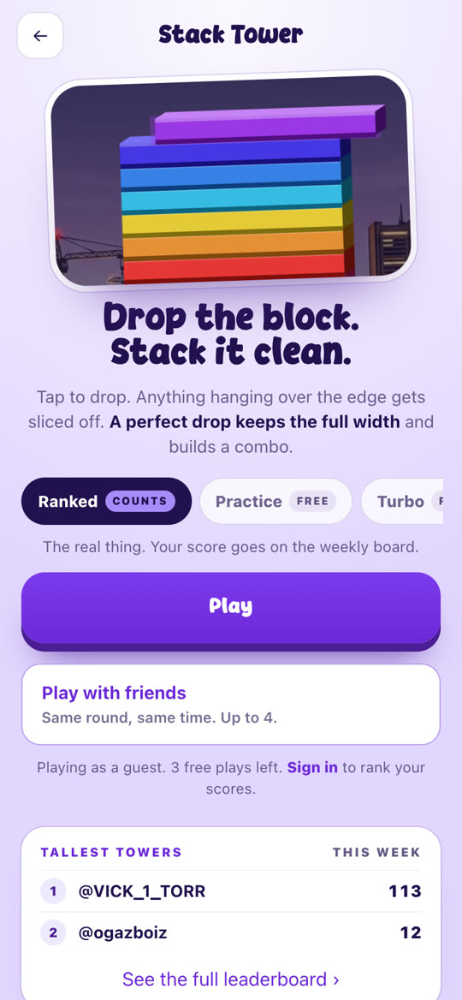

# Friend Rooms. PRD + Architecture + Status

> Play any skill game with up to three friends, on your own phones, at the same time. A signed-in player's round goes on-chain. Rooms in server-checked games can be played for a G$ entry with no money held anywhere.
>
> Status: BUILT on branch `nepa-up-light`, backend deployed. G$ entry is switched on (`ROOM_STAKES=true`). No real staked round and no real on-chain room round has been observed yet. Author: GameArena · Updated 2026-11-24

---

## 1. Why this, why now

Retention data (23 November 2026): 70% of players play on one day only. The games are fine. What is missing is a reason to come back and someone to play against. A friend sending a room link is both.

The earlier answer, Friend Duels on the `DuelEscrow` contract, held players' money in a contract we wrote and never audited. An outside review found real problems in it (section 8). Rooms replace it without holding money at all.

A room is opened from the **Play with friends** card on any game's start screen:

## 2. Goals

- A room in every skill game, with one flow: open, share, play, standings, play again.
- Nothing to install and no socket to drop: works on a weak connection.
- No new money contract. Nothing unaudited ever holds a player's G$.
- A room round by a signed-in player counts the same as a solo run: on-chain, XP, missions, achievements.

## 3. Design

### 3.1 The flow

1. A player taps **Play with friends** on a game's start screen and opens a room. They get a five-letter code and a link (`?room=CODE`).
2. Up to three others join with the code. The host starts when there are at least two.
3. Everyone is dealt the same round (the same ladders, pattern or song) and plays at once. A strip shows how far each player is.
4. Standings appear as results arrive. The host can start another round.

A player whose phone goes quiet for 30 seconds is marked away and no longer waited for. A room nobody has asked about for 20 minutes is removed.

### 3.2 Which games

| Game | Room | Score is the server's own | G$ entry | Recorded on-chain |
|---|---|---|---|---|
| Word Ladder | yes | yes | yes | yes |
| Simon Memory | yes | yes | yes | yes |
| Rhythm Rush | yes | yes | yes | yes |
| Stack Tower | yes | no | never | no |
| UP NEPA 3D (Restore) | yes | no | never | no |
| Street Strike | its own older rooms | no (phones do the physics) | never | no |

### 3.3 On-chain recording

When a signed-in seat finishes a round in a verified game with a score above zero, the server records it gasless, the same way as a solo run, and saves it the same way. The standings answer first and the transaction is sent after, so a slow chain never holds up the result. The player sees "Saving your score on-chain", then a tick and a link, or a plain note if it did not get through.

The browser is never trusted for which wallet a seat is. The site's rooms route checks the Privy sign-in against the claimed wallet and drops any wallet sent in the request body. MiniPay is accepted as it is for solo runs. One wallet is recorded once per room. Guests play and are not recorded.

### 3.4 G$ entry ("pay after")

1. The host picks an entry (50, 100 or 250 G$ by default).
2. Each player signs a G$ EIP-2612 permit made out to the server wallet for exactly that entry, valid 20 to 60 minutes. The server checks the signature, the amount, the expiry and the balance.
3. Nothing moves while the round is played.
4. When it ends, each loser's permit is used once: their entry goes from their wallet to the winner, less the fee (10% by default) to the treasury.

Rules that follow from holding nothing:

- A tie for first, or a round nobody scores in, moves no money.
- A loser who empties their wallet before the end does not pay. It is recorded against their wallet so they can be kept out of staked rooms.
- A permit is only good for the wallet that signed it and the amount it names. If the server key were stolen, the most a thief could take from a player is the one entry that player signed for, within the hour.
- Any signed-in player who holds the entry may stake. There is no verification check (owner's decision, 2026-11-26): an entry between friends is the players' own G$ going from the loser to the winner, so holding it is the only condition. The game must still be one the server scores.
- A payment the chain did not answer for is tried again and can never be taken twice.

## 4. Architecture

| Piece | Where |
|---|---|
| Room rules, staking, on-chain hook | `games-backend/src/modules/rooms/service.ts` |
| Per-game `deal` and `score` | `games-backend/src/modules/rooms/games.ts` |
| Permit checks and token transfers | `games-backend/src/modules/rooms/pay.ts` |
| Routes (`/api/rooms/*`, internal-secret) | `games-backend/src/modules/rooms/routes.ts` |
| Persistence (`friend_rooms` table) | `games-backend/src/modules/rooms/adapters.ts` |
| Wiring, switches, the real recorder | `games-backend/legacy/notifications.js`, `legacy/scores.js` (`core.recordRoomRun`) |
| Browser to backend, wallet check | `frontend/app/api/rooms/[...path]/route.ts`, `frontend/lib/server/roomWallet.ts` |
| Hook and UI | `frontend/hooks/useFriendRoom.ts`, `hooks/useRoomPermit.ts`, `components/FriendsPlay.tsx`, `components/FriendsSheet.tsx` |

Phones poll the room about every 1.2 seconds. Rooms live in memory and are mirrored to the database, so a restart or redeploy does not end them. Room transactions and stake payments go through the same signer queue as solo scores, so they cannot collide on a nonce.

Settings: `ROOM_ONCHAIN` (default on), `ROOM_STAKES` (default off), `ROOM_STAKE_ENTRIES`, `ROOM_STAKE_FEE_BPS`, `ROOM_FEE_WALLET`.

## 5. Tests

- `rooms.test.ts`, `stakes.test.ts`: the rules, with no database or chain.
- `scripts/chain/stakes-anvil.cjs`: the whole staked round against a local chain with the real G$ permit domain.
- Two-phone browser runs against a local room server, including one with a pretend chain for the on-chain line.

## 6. Risks and open decisions

- **Non-payment.** A loser can move their G$ away mid-round. Entries are small on purpose. Still to build: barring wallets with an unpaid entry, and deciding whether the treasury covers an unpaid winner.
- **Wallet claim on MiniPay** is as strong as it is for solo runs, which is: not proven by a signature.
- **Room rounds now count** toward XP, missions, achievements and the weekly boards. Season points are not added. This was a side effect and has not been confirmed as wanted.
- **Stack and UP NEPA 3D rooms** stay casual until their scores can be the server's own.

## 7. Current status

### 7.1 Built

Rooms in five games, persistence, on-chain recording for the three verified games, permit staking, standings UI with transaction state.

### 7.2 Not yet seen in the real world

- A signed-in room round producing a real transaction.
- A real staked round paying out.
- Rooms on real phones over a mobile network.

### 7.3 Next

Server-checked Street Strike rooms (send the throws, replay them), then Stack made checkable; bar non-payers; a nonce check before the score outbox is switched on.

## 8. What this replaces

`DuelEscrow` at `0x5dd223edb320Bc7e5D1DbF0D68512D1917E0c557`. Confirmed problems: a tie pays the room's creator; the join code is visible in calldata; a single validator key resolves every room; no audit. It is not used by friend rooms. At the time of writing it holds 300 G$ in 5 unfilled rooms, which `refundUnfilled(id)` returns. See `docs/duel-rooms/spec.md`.

## Invites that pop up (2026-11-26)

An invite used to reach a friend only through the bell (and a push, if they had allowed one). A friend with the app open never saw it unless they opened the bell, while the host waited in an empty room.

Now the invite drops in at the top of whatever screen the friend is on, within a fraction of a second: who invited them, which game, and one button, "Join". It does not cover the screen or stop a run. It stays for three minutes (the bar drains), then it is only in the bell.

How it travels:

- **A player's own line** (`games-backend/src/modules/friends/line.ts`, socket path `/live/me`). One socket per open app. The server only ever sends on it.
- **The ticket** (`friends/ticket.ts`). The game server cannot check a sign-in itself, so the once-a-minute check-in (`POST /api/friends/ping`, reached only through the site's server after the sign-in is checked) hands back a ticket: this wallet, for ten minutes, signed with a key derived from the server's secret. The phone shows it to open its line. A stolen ticket shows an attacker ten minutes of invites and nothing else.
- **The fallback.** The check-in's answer also carries invites that are still waiting, so a phone whose socket cannot open still gets the pop-up at its next check-in (at most a minute later).
- **In the app:** `frontend/lib/ownLine.ts` (the socket), `components/Presence.tsx` (check-in, which invite to show, never the same one twice), `components/InvitePopup.tsx` (the card).

Limits: 4 open tabs per player (a fifth replaces the oldest), 10,000 lines on the server, 8 messages per 10 seconds from a phone, a connection that does not say who it is within 6 seconds is closed. Invites are held in memory for three minutes; the bell holds the lasting copy. One server holds every line, like the room line: a second server would need a shared channel.

Counted in `site_events`: `invite_shown`, `invite_join`, `invite_closed`, `invite_ran_out`. `GET /internal/live` reports open lines under `me`.

## The room screen, laid out again (2026-11-26)

The owner's phone showed the problem: in a room played for G$, the entry and the "Agree" button sat under the invite list, four seat rows and the chat. A player could sit in a room without ever learning money was involved.

What changed:

- **What the round is played for is the first thing in the room.** A gold band under the title: "50 G$ each · winner gets 45 G$", and how it works in two lines.
- **The one next step is fixed to the bottom of the sheet**, whatever is scrolled: "Agree to 50 G$", "Start for 2", or what is being waited for. Errors appear right above it.
- **Everything else is smaller.** The code is a chip beside the title (tap copies the link). The four seats are a two-by-two grid with a face, a name and a state. The host's "Play for G$" picker sits under the seats, not under the chat.
- **The chat is one line on a phone** (the newest message, and a count of new ones); a tap opens it. On a wide screen it stands open beside the room, and the sheet is twice as wide.

On a 390 px phone the whole room now fits without scrolling in every state, and on a 360 x 640 phone the entry and the action are both in view.

Why: the primary action belongs where a thumb reaches and stays visible while content scrolls ([Toyota design system, sticky bottom bar](https://dx-playbook.toyota-europe.com/cds/modules/sticky-bottom-bar/)); only one thing should stick, never a stack of them ([Smashing Magazine, which elements should stick](https://smashingmagazine.com/2020/01/mobile-pwa-sticky-bars-elements)); on a small screen content takes priority over everything around it ([Smashing Magazine, enhancing mobile UX](https://smashingmagazine.com/2017/05/enhancing-mobile-design-ux)).

Code: `frontend/components/FriendsSheet.tsx` (the sheet is now top, scrolling body, fixed foot; `useStake` is shared by the band, the picker and the bar) and `frontend/components/RoomChat.tsx` (`fold`). To look at each state without a real room: `/dev-preview?room=guest`, `agreed`, `host`, `hoststake`, `solo` (development only).

## The bar at the top of the app (2026-11-26)

On a phone the bar held an avatar, the name, level, streak, freezes, energy, mute, the bell and two balances. The name column was squeezed until "LV 17" broke onto two lines.

Now, on a phone: avatar, the name with **level and streak** under it, the bell, and the G$ balance. Mute moved to the account sheet (tap the balance), where the CELO balance already was; a low CELO balance still shows as a dot on the G$ chip. Energy is shown beside Play and in the chips on the home screen. The bell and the balance are 44 px tall. A wide screen keeps mute and both balances, because it has the room.

Why: a top bar should carry the few actions that serve the main tasks, and push the rest into a menu ([Apple, toolbars](https://developer.apple.com/design/human-interface-guidelines/toolbars)); one or two trailing actions is the usual limit ([Visa design system, top app bar](https://design.visa.com/components/top-app-bar/usage/)).

Code: `frontend/components/AppHeader.tsx`, `AccountSheet.tsx` (the sound row), `app/dashboard/page.tsx` (the energy chip).
