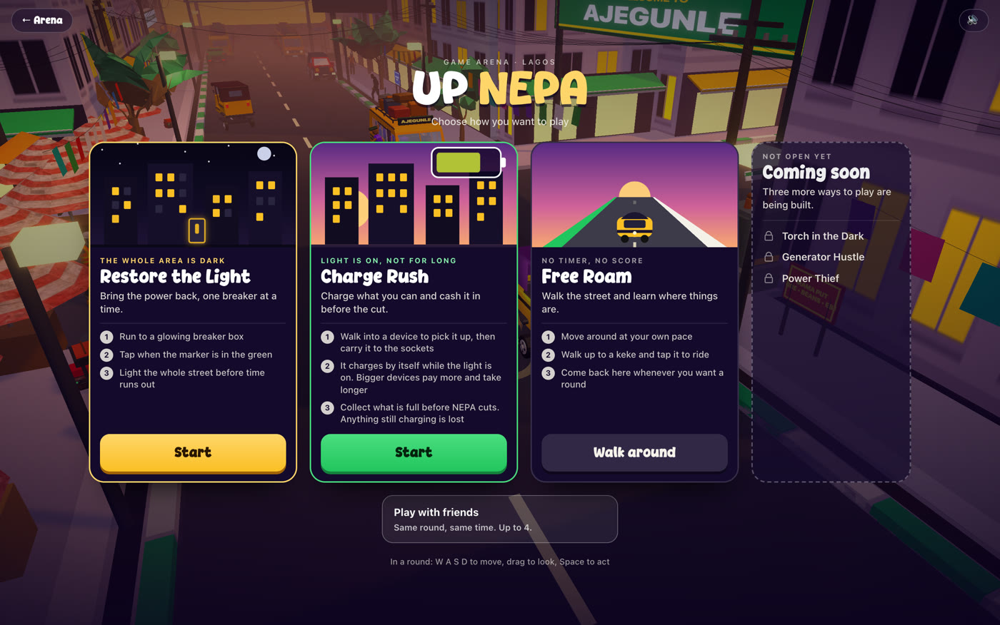
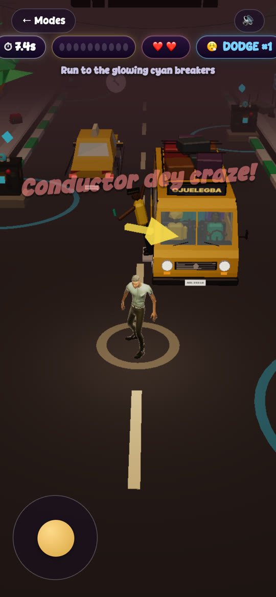
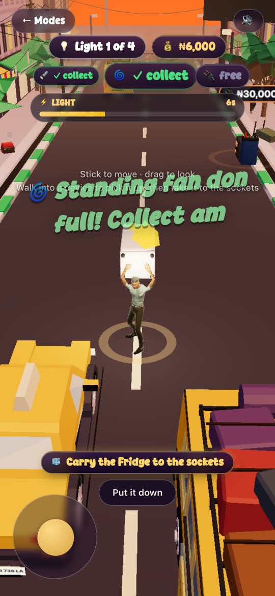

# UP NEPA (3D). PRD + Architecture + Status

> GameArena's walkable 3D Lagos game. The Gidi Hustle / Lagos Life genre (open street, story missions, real vehicles), but built around the one hook those games don't own: **power**. NEPA cut the light, you bring it back. Roam the neighbourhood, hop on an okada or in a keke, run missions, restore the light, climb the board.
>
> Status: IN BUILD on branch `nepa-up-light`, route `/world`. Two modes playable, keke driving MVP in, asset-reconstruction pipeline proven (textured okada+rider shipped). NOT deployed. Launching into GameArena as "coming soon" (tile PR #329). Separate product from the 2D [Up Light](./nepa-up-light-prd.md) reaction game (gameType 4).
>
> **Update, 24 November 2026.** Deployed on the preview of branch `nepa-up-light`; not on the main site until that branch is merged. Since the status above: one palette for the whole street; friend rooms for both modes; scores recorded on-chain as game id 7. Charge Rush was rebuilt as "three sockets" (walk into a device, carry it to the charging table, it charges while the light is on, collect before the cut), and now has Blender-built devices (`frontend/tools/blender/build_devices.py`), a head-carry, a signed charging point, money-at-risk, a pick-one upgrade in every blackout and neighbour rush jobs. The sections below describe the original plan and are kept as written.
>
> Author: GameArena (ogazboiz / @AkpoloOgaga) · Updated 2026-10-13

 

---

## 1. Why this, why now

A viral wave of 3D Nigerian browser games is trending on Lagos Life / Vatar (#lagoslife): Gidi Hustle (GTA-style missions on the real Oshodi map, danfo, okada, POS, police wahala). They prove demand, distribution, and the cultural formula. They compete on **crime/streets**. We don't fight them there. We own the lane they leave open: **electricity**.

- "UP NEPA!" is the most universal Nigerian experience. No notable 3D web game is built on it.
- Same engine class (walkable 3D Lagos, story missions), different soul: you are the one who **brings back the light**, not the one who robs the danfo.
- Same GameArena differentiator the clones structurally cannot copy: **verified humans, on-chain weekly rank, real G$**. Playing your Lagos story actually pays.

**Positioning:** the Lagos games made Nigerians play. This is the one where bringing back the light puts you on a real board.

---

## 2. Vision & pillars

You spawn in a Lagos neighbourhood at dusk. NEPA just carried the light. The whole area runs on gen and candlelight. You roam on foot, walk up to an okada or keke and ride it, and your hustle is **bringing the light back, street by street**, through a chain of story missions. The streets are alive: danfo conductors, okada riders, buka women, area boys, traffic, pidgin everywhere.

1. **Power is the hook.** Every mode/mission is about light, current, fuel, blackout.
2. **Alive, not empty.** Real people on/in vehicles (riders baked into bikes, passengers), NPCs with personality, traffic, street life.
3. **It's 3D — act like it.** One shared, roamable map. Driving, exploring, and missions live in the world, not in menu screens.
4. **Story-driven.** A mission chain gives the roaming a point, like Gidi Hustle's story missions.
5. **Phone-first.** Browser, no download, smooth on low-end Android / MiniPay. **Touch is the primary input.**
6. **Earns real G$.** Mission/score results go on-chain; rewards stay GoodDollar-verified (anti-farming), same as the rest of GameArena.

---

## 3. Tech stack & architecture

| Layer | Choice |
|---|---|
| Rendering | **React Three Fiber (R3F) + three.js** |
| Helpers | `@react-three/drei` (GLB loading, OrbitControls), `@react-three/postprocessing` (desktop only) |
| Bundler | **Next.js** (world lazy-loads client-only at `/world`; no Vite — it lives inside the GameArena app) |
| Physics | **None.** Movement, collision, driving are hand-written. Rapier only if a mode needs it. |
| Language | TypeScript |
| Assets | `.glb` (glTF) loaded with `useGLTF` from `public/world/models/` |

**Key files** (`frontend/app/world/`): `page.tsx` → `World.tsx` (2D shell, input, HUD, overlays); `controls.ts` (`worldControls` singleton — hot per-frame state incl. `input`, `playerPos`, `driving`, `enterExit`); `store.ts` (`useWorldStore` zustand — React-rendered state incl. `driving`); `appStore.ts` (mode: `intro|menu|restore|charge`); `Scene.tsx` (mounts per-mode directors); directors `NepaDirector`/`GameDirector`/`RestoreDirector`/`IntroDirector`; `Player.tsx` (movement + camera follow; hides + hands camera to a vehicle while driving). **Perf:** `frameloop="never"` + manual FrameGovernor (30fps mobile / 60 desktop), AdaptiveDpr, degrade-only, pause-on-hidden, mobile gating of shadows/AA/post.

---

## 4. Modes (become mission types)

In the story-mode world these stop being menu screens and become **mission types** placed on the map.

| Mode / mission type | Hook | Status |
|---|---|---|
| **Restore the Light** | Blackout speedrun — flip ~10 breakers (tap-in-the-green), NEPA surges re-trip them, 2 lives, dodge traffic. | **BUILT** |
| **Charge Rush** | Race the NEPA cut across 5 shrinking light windows. | **BUILT** |
| **Fuel Run** | Ride the keke/okada for petrol in scarcity, haul jerry cans to a dying gen. | planned (driving-based) |
| **Generator Hustle** | Run the street's gen business: buy fuel, keep gens running, serve neighbours. | SOON stub — **next to build** |
| **Torch in the Dark** | Total blackout, phone torch on low battery, find your way/things. | SOON stub |
| **Power Thief** | Tap the transformer / illegal connection without the PHCN van catching you. | SOON stub |
| **Area Light War** | Multiplayer, street-vs-street: who restores + holds the most light. | future (flagship) |

---

## 5. Controls (touch-first)

A phone game, so touch is the design centre. One consistent language; keyboard mirrors it on desktop.

- **Move (on foot):** on-screen joystick, bottom-left (`Joystick.tsx`). Push to walk, tilt to steer.
- **Camera:** drag to orbit, pinch to zoom (OrbitControls).
- **Interact / enter — NO fixed button:** walk up to a vehicle / transformer / buka / NPC → a contextual prompt floats **on the object** ("Ride", "Fix", "Talk") → **tap the prompt** to act. Desktop: same prompt + `E`. **The old corner DRIVE button is removed** (Phase 2); entry is contextual, GTA/Gidi style.
- **Ride/drive:** the joystick becomes the ride control — push up = gas, pull back = brake/reverse, tilt = steer. Later: dedicated **gas/brake pedals** (right) + steer (left), optional **landscape** for the driving/story view. Tap a small "Off" prompt to dismount.
- **Skill beats (timing):** tap the screen / the glowing prompt when the meter is in the green (unified `worldControls.actionTap`).

"The rest" is this one language: **joystick to move, tap-the-prompt to act, tap-timing for skill, drag for camera.** No scattered buttons.

---

## 6. Driving & the living world

- **Ride the vehicles.** Walk up, contextual prompt, get on/in; ride; get off anywhere. `DriveableKeke.tsx` (keke, MVP) + `DriveableOkada.tsx` (okada, rider baked in, built — needs mount + scale/FACE tune). While riding, the vehicle owns the camera (writes `playerPos`), the `Player` hides. The okada's rider is baked into the model, so a person is always visibly on it — **no glass, no hidden occupant** (the clean solution to "see people inside"; closed-cabin vehicles hide occupants behind opaque glass).
- **People everywhere.** `Occupant.tsx` can seat a character inside a vehicle; the reliable visible-people answer is open vehicles (okada) + pedestrians + NPCs.
- **Woven into missions**, not a toggle: you roam, hop on an okada, ride to the junction, run the mission.

---

## 7. Asset pipeline (how Blender + Higgsfield + StableCash connect)

A **file hand-off**, three sources → one destination:

1. **Blender (`/Applications/Blender.app`)** — hand-model/texture in the GUI, OR headless (`Blender --background --python`) to optimize/process (decimate + Draco + texture-downscale). Used headless: vehicles 23MB→5MB, passenger 1.15MB→174KB, okada+rider 5.75MB→568KB.
2. **Higgsfield** — `generate_image` (reference) → `generate_3d` (image→GLB, `should_texture:true` for colour). Proven: seated passenger, textured okada+rider.
3. **StableStudio (StableCash / agentcash)** + Higgsfield images — reference art, textures.

**The flow:** generate/model → export `.glb` → **optimize in Blender (headless)** → `frontend/public/world/models/` → `useGLTF("/world/models/<file>.glb")`. Target < ~1MB/model (Draco), textures ≤ 1024. **Gotcha:** `generate_3d` of intricate/thin geometry (bike spokes) can degrade — inspect every model (headless Blender render) and decimate gently (ratio ~0.75) to preserve shape. Inspect orientation/dims before setting in-game SCALE/FACE.

---

## 8. Phased build plan (THE ROADMAP)

Built in phases, honest about scale — this is a multi-session build, not one pass. Each phase ends with a Judge pass (§10).

**Phase 0 — Reconstruct the assets.** Rebuild the full set through the pipeline, one consistent stylized look, all textured + optimized.
- Vehicles: **okada (DONE, 568KB)**, keke, danfo, taxi (re-gen to match the new style).
- People: rider (in the okada), passenger (DONE), driver, buka woman, area boy — a small cast.
- Props: transformer, generator, jerry can, POS umbrella, buka stand, fuel pump.

**Phase 1 — The map.** Grow the single street into a small walkable **district**: main road + a side street + a junction (the transformer), a filling station, a buka/market corner. Modular from the asset tiles. The world missions live on.

**Phase 2 — Natural movement + driving.** Remove the DRIVE button. Contextual tap-to-enter on the vehicle. Mount + tune the okada. Ride controls (joystick → pedals option, landscape option).

**Phase 3 — Story mode.** A mission chain, all power-themed. Each mission = map location + objective + skill beat (Restore / Charge / Fuel-run as mission types). Mission director, map markers, pidgin dialogue. "Junction transformer blow" → ride there → fix it. "Van dey come" → beat them.

**Phase 4 — Life + polish.** NPCs with personality, NEPA day/night cycle tied to missions, pidgin barks, collisions, weekly leaderboard for mission times, on-chain scoring wire-up.

**Start now:** Phase 0 + Phase 1 together — reconstruct the core assets (okada done) and build one small, dense, *alive* block. Then missions drop onto it.

---

## 9. GameArena integration

- **Entry point:** "UP NEPA" SOON tile in the games hub (PR #329), `href: /world`, flips to playable once wired + deployed.
- **Leaderboard:** mission/mode scores record on-chain via the existing `recordScore(player, gameType, score)` validator path; new `gameType` for the 3D ladder. All-time board shows them; reward/Cup ladder stays GoodDollar-verified (anti-farming).
- **Rewards:** GoodDollar-gated.
- **Distribution:** inside GameArena, a registered platform on **Lagos Life / Vatar** — same funnel as Gidi Hustle, plus the Celo on-chain layer. See [[project_vatar_integration]].

---

## 10. How we work — the department loop

Run the build as a multi-agent loop, each department acting on its own, every phase:

- **Builder** — implements the phase's code.
- **Adversarial auditor** — attacks it: exploits, bugs, perf cliffs, weak points (ranked).
- **Fixer** — fixes every finding, with regression tests.
- **Design researcher** — goes external, studies the best real game UIs / Lagos set-dressing, raises the bar.
- **Judge** — grades the current state against the rubric (wow-beat, cultural authenticity, polish, perf-on-real-phone, clarity, fun) and says exactly what loses points.

Loop until the Judge clears the phase, then advance. (This repo has run this loop before — see [[project_nepa_3d_world]] for prior audit/judge findings to carry forward.)

---

## 11. Status (2026-10-13)

**Built & working:** the 3D street (buildings, lighting, traffic, pedestrians, props), `Restore the Light` + `Charge Rush`, intro, perf engineering.

**Done this session (big):**
- **Real physics** — Rapier (`@react-three/rapier`). Fixed a root frame-delta bug (`advance(t/1000)`) that was making ALL motion ~60x wrong. `FreeRoam.tsx` wraps the free-roam in `<Physics>` with colliders; `PhysicsPlayer.tsx` = kinematic character controller.
- **Free-roam is the default** — you spawn and roam; the mode-select is an on-demand "Play a mode" launcher, not a blocking screen.
- **Rideable keke (DONE, great)** — authentic Sketchfab "Keke Napep" (by Flashtech, CC-BY, `models/CREDITS.md`), imported via Blender MCP, optimised to ~370KB. Momentum/collision/lean physics, a driver, and its OWN tyres actually spin (front wheel + rear axle; silver rims so you see it). The spin bug was real: wheel nodes were collected in `useMemo` (render-time) → React dev double-render desynced them from the on-screen model → fixed by collecting in `useEffect` + `matrixAutoUpdate=true`. **Lesson: don't hand-model vehicles — generate/import, see [[feedback_no_handmodel_vehicles]].**
- **Phase 1 map — a named multi-district crossroads.** The junction is now a 4-way crossroads and the map reads as real Lagos areas via `AreaSign.tsx` gantries:
  - **Ojuelegba / Mile 2** (main road): the far end is a **Mile 2 motor park** (danfos loading under the MILE 2 gantry + a bus shelter).
  - **Ajegunle** (+X branch): road + buildings, a market/buka corner, the **filling station**, the **NEPA transformer** landmark, parked danfo + keke.
  - **Oshodi** (−X branch): a packed market (umbrellas + stalls both kerbs) + buildings.
  - `LagosBuildings` leaves both junction gaps; `FreeRoam` splits both walls + adds every branch's ground/walls; the keke drives through all of it (road-clamp removed). All in `SideStreet.tsx`.
- **Phase 2 STARTED** — removed the corner DRIVE button; entering is the contextual in-world "Tap to ride" prompt (corner button is GET OFF only, while riding).

**Next (Phase 1 continue):** extend the district (more blocks / a second junction), the filling station on the side street, drop the junction's main-sidewalk curb for a clean corner, then Phase 3 missions onto the map. Blender MCP + Sketchfab is the asset path (see [[reference_blender_mcp]]).

**Not done:** on-chain 3D scoring; in-arena entry route (tile is SOON); story mode (Phase 3). Game modes (Restore/Charge) load fine but want a feel re-tune after the delta fix. NOT deploying yet. Dead files to delete (`Buildings.tsx`, `CityFacades.tsx`, `LitWindows.tsx`).

---

## 12. Go-live & marketing

**Go-live:** finish Phases 0–2 → wire a mode's score on-chain → flip the hub tile to playable + add an in-arena route → push `nepa-up-light`, deploy (Vercel; Railway if the gameType needs server; subgraph fast-follow for per-player best).

**Marketing:** trailer built (`marketing/upnepa-trailer/`, Remotion + Higgsfield + pidgin voice, v2 mostly-motion 19s vertical); X launch post ("coming soon to GameArena … #lagoslife #upnepa" + trailer); coming-soon tile live on gamearenahq.xyz.
